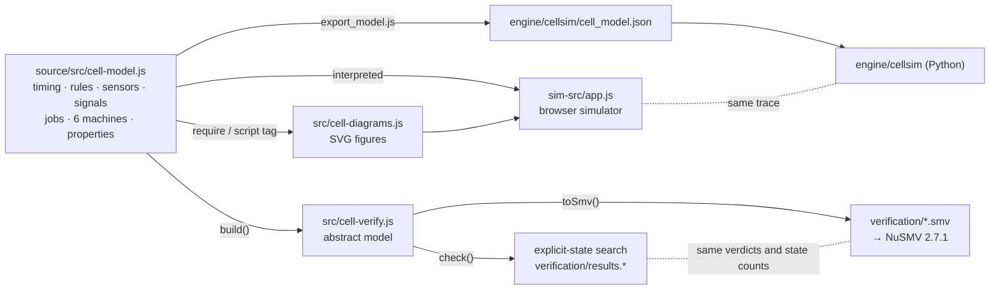

# CNC Cell Simulator: project status and technical reference

Checkpoint of the project on **2026-10-23**. This file describes what exists, how every part works,
how the parts depend on each other, what has been checked, what is out of date, and how to extend
the project without breaking it. `README.md` is the public summary; this file is the engineering
reference behind it.

---

## 0. Snapshot

| Item | Value |
|---|---|
| Repository | https://github.com/juanlopez-gif/CNC-Cell-Simulator (public) |
| Live simulator | https://juanlopez-gif.github.io/CNC-Cell-Simulator/ (GitHub Pages from `main`, root `index.html` redirects to `simulation/`) |
| Branch `main` | `6204b09` "Separate the simulation engine into a Python package without graphics" (2026-10-21) |
| Branch `state-machines-as-data` | Same commit `6204b09` (local and `origin`); kept only as history, no extra work on it |
| Working tree | Clean, in sync with `origin/main` (before this file was added) |
| Toolchain used | Node.js 24.19.0, Python 3.11.8, Google Chrome (headless via puppeteer-core), NuSMV 2.7.1, Windows 11 |
| Built by | Claude Code (one agent, model Claude Opus 5.5) directed by the author, in one long session from 2026-09-28 to 2026-10-22 |

### Health check run for this checkpoint (2026-10-23)

| Check | Command | Result |
|---|---|---|
| Model lint | `node -e "console.log(require('./src/cell-model.js').lint())"` | `[]` (no problems) |
| JSON export for Python is current | `node export_model.js --check` | "model export up to date" |
| Python engine tests | `python -m unittest test_engine` (in `engine/`) | 5 tests OK in 85 s |
| Published simulator = fresh build | `node build_sim.js` and compare with `simulation/index.html` | Identical except Windows line endings (CRLF from git) |
| Committed diagrams = fresh generation | Regenerated the 14 SVGs from `src/cell-diagrams.js` | 14 / 14 identical |
| Committed NuSMV models = fresh export | `V.toSmv(V.build(...))` for the 6 runs | 6 / 6 identical (36 / 44 variables, 229–295 commands) |
| KPIs from the model | `M.KPI` | idle 36.5 s / 20.5 s, cycle 156.5 s / 140.5 s, utilization 76.7 % / 85.4 %, 23.0 / 25.6 parts/h |

Not re-run for this checkpoint (they need `npm install` or take long): `node test_sim.js all`
(headless browser tests, about 20 h of simulated conformance runs) and `verify.js` (exhaustive
search, minutes; NuSMV, about 1 h). Their last results are the committed ones in
`verification/results.md` (2026-10-02) and the logs of commit `6204b09`. Since then no file in
`source/src` or `source/sim-src` has changed, so those results still apply.

> `source/node_modules` is **not installed** in the repo folder right now (`npm ls` reports
> unmet `docx` and `puppeteer-core`). Run `npm install` in `source/` before any script that uses
> Chrome or writes Word files.

---

## 1. What the project is

The solution to the ISE 401 Week 2 "Sensors Design Task" for a CNC machine-tending cell:

- **Setup 1.** An operator loads a pallet of 50 × 50 × 50 mm aluminium blocks. Robot 1 (UR10e)
  opens the CNC door, loads a block into the vise, and after the 120 s cycle unloads the finished
  part onto a conveyor. Robot 2 picks it at the conveyor exit and places it on an output pallet
  (12 slots). A blue light signals a full pallet. Robots pick or place at the belt only while it is
  stopped.
- **Setup 2.** Every part is measured; any length, width or height below 48.00 mm (nominal 50 −
  2 mm) goes to a locked NOK chute. CNC time is optimized with a dual gripper on Robot 1 and a gauge
  served by Robot 2 while the CNC machines.
- **The author's design rule.** At each checkpoint a proximity/photoelectric sensor and a camera
  must agree. On disagreement the camera value is used and a mismatch is logged. Three mismatches
  within 10 minutes stop the line until a technician verifies the sensors. Safety is hardwired and
  never overridden by the camera.

The project grew from that assignment into a **model-driven** system: the four state machines of the
cell are data in one file, and the diagrams, the browser simulator, the Python engine and the
formal verification are all generated from or interpret that file.

---

## 2. History in one table

| Date | Commit | What changed |
|---|---|---|
| 2026-09-28 | `7d29395` | First complete version from one prompt: 27-page report, 14 diagrams, browser simulation. State machines were written separately in the diagrams and in the simulator. |
| 2026-09-28 | `7697eae`, `99bc009` | GitHub Pages entry page; README link to the live simulator. |
| 2026-09-30 | `331205c` | Human-caught error fixed: the dual-gripper exchange is now drawn and simulated clearly (fig14). 4-page short answer added. Demo video added. |
| 2026-10-01 | `9846a4d` | **Machines as data**: states, steps, transitions and guards moved into `src/cell-model.js`. Diagrams and simulator generated from / interpret it. KPIs computed. Lint and conformance test added. |
| 2026-10-01 | `0986e51` | Exhaustive verifier (`src/cell-verify.js`, `verify.js`), 13 properties, NuSMV export, results. |
| 2026-10-02 | `26572f1` | NuSMV 2.7.1 run on all six models; encoding fixed for speed (IVAR command, stutter, invariants); verdicts and state counts agree. |
| 2026-10-21 | `6204b09` | Python engine `engine/cellsim` (no graphics), JSON export of the model, browser-vs-Python trace comparison. Merged to `main` and pushed. |

Problems found by the checks after round 2 (all fixed, listed in `README.md`): 2 latent design bugs
(cycle-start handshake waiting for a short signal; "pick allowed" never consumed), 1 rule the
assignment left open (when CP-2 counts as clear; the old simulator read the true part position),
2 errors introduced while writing the model (too general hold rule; one machine reading another
machine's check result).

---

## 3. Repository map

```
Week2_Sensors_Design/
├── README.md                        public summary (figures, key numbers, rebuild commands)
├── PROJECT_STATUS.md                this file
├── index.html                       GitHub Pages entry: meta-refresh to simulation/
├── .nojekyll                        Pages serves files as they are
├── .gitignore                       node_modules, source/out, Office temp files, __pycache__, *.pyc
├── Week2_Assignment_Answer.docx/.pdf   4-page course answer (round 1, frozen)
├── Sensors_Design_Report.docx/.pdf     27-page full report (round 1, frozen)
├── demo_system_working.mp4          51 MB demo video of the simulator (round 1)
├── diagrams/                        fig01–fig14 as SVG (editable) and PNG (2x), generated
├── simulation/
│   ├── index.html                   the simulator, one self-contained file (≈ 240 kB), generated
│   └── sim_*.png                    screenshots used in README and report
├── verification/
│   ├── cell_setup{1,2}_{none,sensor,process}.smv        NuSMV models, generated
│   ├── cell_setup{1,2}_{none,sensor,process}.nusmv.txt  NuSMV outputs
│   ├── results.json                 every number of the last verification run
│   └── results.md                   human-readable results (tables of runs and properties)
├── engine/                          Python engine, no graphics (see §7)
│   ├── README.md
│   ├── cellsim/__init__.py          exports CellSim, Model, load, conformance, run_random
│   ├── cellsim/model.py             loads the JSON model; guard parser/evaluator/text
│   ├── cellsim/sim.py               interpreter, scheduler, plant, property monitors
│   ├── cellsim/scenarios.py         random long runs; conformance check
│   ├── cellsim/cell_model.json      the model exported from JS (generated, do not edit)
│   ├── run.py                       command line
│   ├── test_engine.py               5 unit tests
│   └── trace.py                     prints a scenario trace as JSON (used by test_sim.js engine)
└── source/                          everything that generates the outputs
    ├── package.json                 deps: docx ^9.8.1, puppeteer-core ^25.12.0; npm scripts
    ├── src/cell-model.js            ★ THE MODEL (single source of truth), 909 lines
    ├── src/cell-diagrams.js         SVG generator for all figures + cell layout, 1105 lines
    ├── src/cell-verify.js           abstract model, explicit-state search, NuSMV export, 724 lines
    ├── sim-src/app.js               simulator: interpreter + plant + drawing + UI, 1043 lines
    ├── sim-src/app.css, body.html   simulator style and markup
    ├── build_sim.js                 bundles model + diagrams + app into one HTML file
    ├── render.js                    writes every figure as SVG and PNG (Chrome)
    ├── verify.js                    runs the 6 verification runs (+ NuSMV), writes results
    ├── export_model.js              writes engine/cellsim/cell_model.json (--check mode)
    ├── test_sim.js                  headless tests: basic | fault | s2 | mobile | conform | engine | all
    ├── capture_sim.js               simulator screenshots for the report
    ├── capture_exchange.js          5 crops of the dual-gripper exchange (fig14 source)
    ├── build_report.js              27-page Word report (docx library)
    └── build_answer.js              4-page Word answer (docx library)
```

Outside the repository (on purpose):

- `ISE 401 TFG/tools/NuSMV-2.7.1-win64/bin/NuSMV.exe`: the NuSMV binary used for the checks.
- `ISE 401 TFG/tools/work/`: scratch files of the NuSMV runs and PDF printing.
- Research notes and talk material kept outside the public repo.
- Private claude.ai pages: the simulator (https://claude.ai/artifact/HgSKTvKdnatiaWJAGKfh6e), the
  "how we built it" guide (https://claude.ai/artifact/S1Qjp6tfkap7N9mtdTudAJ) and the talk deck.

---

## 4. Architecture

### 4.1 One model, many consumers



Rules that keep it consistent:

1. **No state name, transition or guard text exists anywhere except `cell-model.js`.** The
   diagrams generate arrow labels from guards; the simulator and the Python engine interpret the
   machines; the verifier compiles them.
2. **Plant ≠ controller.** The model is the controller (what the PLC would run). Each consumer
   brings its own plant: the browser and Python have a timed plant (robot motions, belt physics,
   sensors, operator); the verifier has a nondeterministic, untimed plant.
3. **Generated files are committed** so the repo works without building: `diagrams/`,
   `simulation/index.html`, `verification/*`, `engine/cellsim/cell_model.json`. After changing the
   model you must regenerate them (see §12).

### 4.2 How the browser loads it

`build_sim.js` concatenates into one HTML page: Google Fonts link, `app.css`, `D.CSS`,
`body.html`, then three `<script>` blocks in order: `cell-model.js` (sets `window.CellModel`),
`cell-diagrams.js` (`window.CellDiagrams`), `app.js`. The same JS files also work in Node through
`module.exports`. Output: `out/sim/index.html` (stand-alone) and `out/sim/artifact.html` (no
document skeleton, for claude.ai). Copy `out/sim/index.html` to `simulation/index.html` to publish.

---

## 5. The model (`source/src/cell-model.js`)

Exported object `MODEL`:
`T, TLABEL, KPI, RULES, CHECKPOINTS, SENSORS, STATES, idleSetup1, idleSetup2, SLOTS, SIGNALS,
CONST, OUTPUTS, RUNGS, PROPERTIES, JOBS, MACHINES, SETUP_MACHINES, IDLE_MACHINE,
expr: { parse, evaluate, names, terms, label, plain, visible, constVal }, jobTime, stateSteps,
stateTime, lint`.

### 5.1 Timing `T` (seconds)

| Group | Values |
|---|---|
| CNC | `cncCycle` 120 · `unlock` 0.5 · `lock` 0.5 · `cycleStart` 0.5 |
| Robot 1 door work | `homeToDoor` 1.5 · `doorToHome` 1.5 · `park` 1.5 · `doorOpen` 4.0 · `doorClose` 4.0 |
| Robot 1 in the CNC | `enterCnc` 2.0 · `exitCnc` 2.0 · `grip` 0.5 · `release` 0.5 · `viseOpen` 1.0 · `viseClamp` 1.0 · `lift` 1.0 · `placeInVise` 1.0 · `seatCheck` 0.5 · `swapGripper` 1.5 |
| Robot 1 transfers | `doorToConv` 2.5 · `placeConv` 2.0 · `convToPallet` 2.0 · `pickPallet` 2.0 · `palletToDoor` 2.5 |
| Checks | `check` 0.5 (settle + snapshot + compare) |
| Belt | `beltTravel` 8.0 (2 m at 0.25 m/s) · `beltStart` 0.3 · `beltStop` 0.3 · `zeroSpeed` 0.2 |
| Robot 2 | `r2ToExit` 1.5 · `r2Pick` 1.0 · `r2ToPallet` 1.5 · `r2Place` 1.0 · `r2Home` 1.0 · `r2ToGauge` 1.5 · `r2LoadGauge` 1.5 · `measure` 1.0 · `r2Repick` 1.0 · `r2ToNok` 1.5 · `r2Drop` 0.5 |

`TLABEL` gives each key a readable name for the CNC-idle build-up table.

### 5.2 Rules `RULES`

`mismatchWindow` 600 s · `mismatchLimit` 3 · `settle` 0.3 s · `debounce` 0.05 s · `retrigger` 0.3 s
(second image after an invalid one) · `confirmTimeout` 1.0 s · `minSize` 48.0 mm · `nominal` 50.0 mm
· `consecutiveNokHold` 2 · `palletSlots` 12. `CONST` exposes `limit`, `slots`, `nokHold` to guards.

### 5.3 Checkpoints `CHECKPOINTS`

| Id | Where | Proximity | Camera / ROI | Fact | Setup |
|---|---|---|---|---|---|
| CP-1 | Input pallet | PX-11 | CAM-1 / ROI-A | Input pallet present and seated | 1, 2 |
| CP-2 | Conveyor entry | PE-41 | CAM-1 / ROI-B | Part at conveyor entry | 1, 2 |
| CP-3 | Conveyor exit | PE-42 | CAM-2 / ROI-C | Part at the end stop | 1, 2 |
| CP-4 | Output pallet | PX-52 | CAM-2 / ROI-D | Output pallet present | 1, 2 |
| CP-5 | Gauge nest | PX-64 | CAM-2 / ROI-E | Part in gauge nest | 2 |

### 5.4 Sensors `SENSORS`

Each entry: `tag, zone, kind, setup, type, where, confirms, example` (catalogue example, no prices;
prices live only in `build_answer.js`). Tags used across the project:

- Robot 1 / CNC: PX-11, CAM-1, GR-21 (GR-21A / GR-21B in Setup 2), ZS-31 door open, ZS-32 door
  closed, ZS-33 guard lock, ZS-34 vise open, ZS-35 clamped, PS-36 part seated (SMC ISA3 air gap).
- Conveyor: PE-41, PE-42 (through-beams), ENC-43 (encoder on an idler roller), CAM-2.
- Robot 2 / output: GR-51, PX-52, LT-53 blue beacon.
- Cell: LT-01 stack light, SC-01/SC-02 area scanners, PLC-01.
- Setup 2: LS-61/62/63 laser displacement sensors (Keyence IL-065), PX-64, PE-65 NOK drop,
  MST-60 master cube.

### 5.5 Signals `SIGNALS` (everything a guard can read)

Every name has a `kind`:

| kind | Meaning | Examples |
|---|---|---|
| `sensor` | Device signal. Simulator reads its plant; verifier an abstract plant | `ZS-31`, `ENC-43`, `CNC.done`, `R1.clearCnc`, `GAUGE.ok`, `outCount` |
| `check` | Fused result of the **last cross-check made by the machine that reads it** (camera decides). A machine never reads another machine's check | `CP-1`…`CP-5`, `CAM-1.part` |
| `var` | PLC variable written by steps | `partPlaced`, `pickAllowed`, `partPicked`, `QH`, `consecNok`, `mismatches`, `CAM_FAULT` |
| `input` | Operator / technician button | `HMI.clear`, `HMI.verify`, `HMI.reset`, `HMI.release`, `VERIFY.pass`, `VERIFY.fail` |
| `derived` | Defined by `def` (expression) | `BELT.free`, `PALLET.full`, `PALLET.empty`, `lineStop`, `FAULT.any`, `CELL.stopped`, `HOLD.req` |
| `truth` | Physical truth, **only for properties** (lint forbids them in guards) | `TRUE.entryPart`, `TRUE.outPallet`, `TRUE.r2Nok` |

Other fields: `on` / `off` (diagram text for true / false; `{TAG}` = sensor, `[CP-n]` =
checkpoint, `*bold*`), `ask` (question text when the signal decides a choice state), `tags`
(sensors behind the signal), `num`/`max`/`text`/`phrases` (counters).

Important derived signals:

- `BELT.free = !ENC-43 & (CONV=C1 | CONV=C5) & !partPlaced` — the fix of the "CP-2 entry clear" rule.
- `lineStop = SUP=X3 | SUP=X4`; `HOLD.req = lineStop | CAM_FAULT`.
- `CELL.stopped = R1.home & R2.home & !ENC-43`.

### 5.6 Guard language

Grammar (in `parse`): `or := and ('|' and)*`, `and := unary ('&' unary)*`,
`unary := '!' unary | '(' or ')' | name [rel value]`, `rel := = != < <= > >=`. Names may contain
letters, digits, `.`, `_`, `-`. A slot name (`R1`, `CONV`, `R2`, `SUP`) reads that machine's
current state id (`CONV=C5`); `R1.job` reads the running job (`R1.job=CNC.start`). Values may be
constants from `CONST`. `evaluate(expr, read)` expands derived signals; `label()` turns a guard into
wrapped diagram text; the Python `model.py` reimplements the same parser and evaluator.

### 5.7 Jobs `JOBS`

A job is a robot program or device command that a step starts and that reports "done". Fields:
`robot` (R1, R2 or null), `time` (list of `T` keys, the planning estimate), `zone` (where the robot
is while it runs: free, door, cnc, conv, pallet, gauge, nok), `at: 'home'`, `move: [from, to]` (part
transfer, used by the verifier's plant), `set` (device state after the job), `canFail: 'grip'`,
`labels`, `tags`, `text`.

28 jobs: `R1.home, R1.park, R1.openDoorFromHome, R1.openDoor, R1.closeDoor, R1.unload,
R1.toConveyor, R1.placeConv, R1.pickRaw, R1.load, R1.pickRawA, R1.toDoorReady, R1.enterCnc,
R1.unloadB, R1.loadA, R1.toConveyorB, R1.placeConvB, DOOR.lock, CNC.start, R2.home, R2.park,
R2.pickConv, R2.placePallet, R2.loadGauge, R2.repick, R2.dropNok, GAUGE.measure, GAUGE.master`.

### 5.8 Machine format

```
MACHINE = { slot, setup (0 = both), title, sub, note, urgent?, view,
            initial: { to, when?, do?, text? },
            hold?:  { desc, do, exit },     // global H state (LINE STOP)
            fault?: { desc, exit },         // global F state
            states: { id: STATE | CHOICE } }

STATE  = { name, desc[], kind?, band? (run|idle|stop|move), wait?, hold?: false, short?, time?[],
           log?, hmi?, do: [STEP...], next: [TRANSITION...], faults?: [{ after, when?, text }] }
STEP   = { job, when?, confirm? }                 start a job, wait for done; confirm must hold, else FAULT
       | { check: 'CP-n', quick?, confirm?, until? } camera + proximity cross-check
       | { await: expr }                          wait until expr holds
       | { set: {var: value}, when? } | { inc: var }
TRANSITION = { to, when, text?, for? (T key: guard must hold this long), hold?: false, do?: [{ set?, text }] }
CHOICE = { choice: signal, yes, no, yesText?, noText? }   pseudo-state (diamond in diagrams)
```

Semantics shared by both simulators:

- On entry a state runs its `do` steps in order, then evaluates `next` in order; the first true
  guard fires.
- `wait: true` = waiting state without confirmation timeout. Otherwise a confirmation that does not
  arrive within `RULES.confirmTimeout` sends the machine to **F** (the alarm names the missing
  sensor). After `HMI.clear` the state is repeated. No automatic robot retries.
- **H (HOLD)** is entered when `HOLD.req` holds: at a transition (the pending state follows after
  the hold), while waiting (the state is entered again), or at once after a camera fault (the same
  check is repeated). `hold: false` on a state or transition = a LINE STOP does not interrupt it
  (a running transport finishes). Robots park in H; exit when `!HOLD.req`.
- `SUP` is `urgent`: it reacts in the same scan as the check that caused it.
- `band` drives the CNC-idle KPI and the timing chart: every Robot 1 state with `band: 'idle'`
  counts toward CNC idle time.

### 5.9 The six machines

`SETUP_MACHINES = { 1: [R1S1, CONV, R2S1, SUP], 2: [R1S2, CONV, R2S2, SUP] }`.

**R1S1 — Robot 1 + CNC, Setup 1, single gripper** (11 entries incl. choice)

| State | Does | Leaves when |
|---|---|---|
| A0 START-UP CHECKS | home robot | `R1.home & CNC.ready & ZS-32` → A1 |
| A1 WAIT FOR CNC (run, wait) | home | `(CNC.done & !ZS-33) \| CNC.empty` → A2 |
| A2 OPEN CNC DOOR (idle) | `R1.openDoorFromHome` | `ZS-31 & !ZS-32` → Q_A2 |
| Q_A2 choice `PS-36` | | yes → A3 (finished part), no → A5 (first cycle) |
| A3 UNLOAD CNC (idle) | `R1.unload` | `GR-21 & ZS-34 & !PS-36 & R1.clearCnc` → A4 |
| A4 PLACE ON CONVEYOR (idle) | to conveyor, await `BELT.free`, quick check CP-2 must be clear, place, check CP-2, set `partPlaced` | `CP-2 & R1.clearConv` → A5 |
| A5 PICK RAW PART (idle) | check CP-1, `R1.pickRaw` if pallet and part | `GR-21` → A6; `!CP-1 \| !CAM-1.part` → W1 |
| A6 LOAD CNC (idle) | `R1.load` | `ZS-35 & PS-36 & !GR-21 & R1.clearCnc` → A7 |
| A7 CLOSE CNC DOOR (idle) | `R1.closeDoor`, `DOOR.lock` | `ZS-32 & ZS-33` → A8 |
| A8 START CYCLE (idle) | `CNC.start` | `CNC.run \| CNC.done` → A1 |
| W1 WAIT FOR INPUT PALLET | park | `HMI.loaded` → A5 |

**R1S2 — Robot 1 + CNC, Setup 2, dual gripper A (raw) / B (finished)**

| State | Does | Leaves when |
|---|---|---|
| B0 START-UP CHECKS | home | `R1.home & CNC.ready & ZS-32` → B1 |
| B1 PICK RAW PART (A) (run) | check CP-1, `R1.pickRawA` | `GR-21A` → B2; no pallet/part → W1 |
| B2 WAIT AT CNC DOOR (run, wait) | `R1.toDoorReady` | `(CNC.done & !ZS-33) \| CNC.empty` → B3 |
| B3 OPEN DOOR (B) (idle) | `R1.openDoor` | `ZS-31 & !ZS-32` → B4 |
| B4 EXCHANGE PARTS (idle) | `R1.enterCnc`; `R1.unloadB` if `PS-36` (confirm `GR-21B & ZS-34 & !PS-36`); `R1.loadA` | `ZS-35 & PS-36 & !GR-21A & R1.clearCnc` → B5 |
| B5 CLOSE DOOR (A) (idle) | close, lock | `ZS-32 & ZS-33` → B6 |
| B6 START CYCLE (idle) | await `!QH`, `CNC.start` | `CNC.run \| CNC.done` → Q_B6 |
| Q_B6 choice `GR-21B` | | yes → B7, no → B1 (first cycle) |
| B7 PLACE ON CONVEYOR (B) (run) | as A4 with `R1.placeConvB` | `CP-2 & R1.clearConv` → B1 |
| W1 | as Setup 1 | → B1 |

The finished part goes to the belt **while the CNC already machines** the next part (B7 is in the
run band), which is where the 16 s of CNC idle time are saved.

**CONV — Conveyor (both setups)**

| State | Does | Leaves when |
|---|---|---|
| initial | quick checks CP-2, CP-3 | `!CP-2 & !CP-3` → C1 |
| C1 EMPTY - STOPPED (wait, hold:false) | clear `partPicked`, `pickAllowed` | `partPlaced` → C2 |
| C2 PART AT ENTRY | clear `partPlaced`, await both robots clear, quick CP-3 must be clear | `R1.clearConv & R2.clearConv & !CP-3` → C3 |
| C3 TRANSPORTING (move, wait, hold:false) | motor on (output `BELT.motor`) | `PE-42 \| ROI-C` → C4 (OR logic: stopping is the safe direction). Faults: no ENC-43 pulses in 1 s; no PE-42 in 15 s |
| C4 STOPPING (move) | motor off | `!ENC-43` for `zeroSpeed` → C5 |
| C5 PART AT EXIT (wait, hold:false) | check CP-3 (confirm), set `pickAllowed` | `partPicked & R2.clearConv` → C1 |

**R2S1 — Robot 2 + output pallet, Setup 1**

D0 start-up (home, check CP-4) → D1 wait for part (`CONV=C5 & pickAllowed & !ENC-43`) → D2 pick from
conveyor (`R2.pickConv`, quick CP-3, then `partPicked=true, pickAllowed=false` if `GR-51 & !CP-3`) →
D3 place on output pallet (check CP-4 confirm, `R2.placePallet`) → Q_D3 `PALLET.full` → D4 wait for
pallet swap (LT-53 on, await `PALLET.empty`, check CP-4 until true) or back to D1.

**R2S2 — Robot 2 + gauge + sorting, Setup 2**

E0 start-up (home, CP-4, CP-5 nest empty, `GAUGE.master`) → E1 wait for part → E2 pick → E3 load
gauge (check CP-5) → E4 measure (`GAUGE.measure`, until `GAUGE.valid`) → Q_E4 `GAUGE.ok`:
yes → E5 place OK part (consecNok = 0, re-pick, CP-4, place) → Q_E5 `PALLET.full` → E7 swap or E1;
no → E6 NOK chute (re-pick, drop, `inc consecNok`, `QH = true` when `consecNok >= 2`; leaves on
`PE-65`). The rung `HMI.release & QH → QH=false, consecNok=0` releases the quality hold.

**SUP — cross-check supervisor (both setups, urgent)**

X1 NORMAL → X3 on `CAM_FAULT`, → X2 on `mismatches>0`. X2 MISMATCH WARNING → X3 on
`mismatches>=3 | CAM_FAULT`, → X1 when the window is empty. X3 LINE STOP → X4 on
`CELL.stopped & HMI.verify`. X4 SENSOR VERIFICATION → X1 on `VERIFY.pass & HMI.reset` (clears
`mismatches` and `CAM_FAULT`); `VERIFY.fail` stays in X4.

### 5.10 Outputs `OUTPUTS` (Moore outputs)

`BELT.motor = CONV=C3` · `LT-53 = R2=D4 | R2=E7` (blue, pallet full) · `LT-01.red = lineStop |
FAULT.any` · `LT-01.amber` = no red and (`mismatches>0 | QH | R1=W1`) · `LT-01.green` otherwise.

### 5.11 Properties `PROPERTIES`

| Id | Kind | Expression | Setup |
|---|---|---|---|
| P1 | never | `(!R1.clearConv \| !R2.clearConv) & ENC-43` | both |
| P2 | at start of `CNC.start` | `ZS-32 & ZS-33` | both |
| P3 | never | `!R1.clearCnc & (!ZS-31 \| CNC.run)` | both |
| P4 | at start of `R1.openDoor`, `R1.openDoorFromHome` | `!CNC.run & !ZS-33` | both |
| P5 | at start of `R1.placeConv`, `R1.placeConvB` | `!TRUE.entryPart & !ENC-43` | both |
| P6 | at start of `R2.placePallet` | `TRUE.outPallet & outCount<slots` | both |
| P7 | at start of `R2.placePallet` | `!TRUE.r2Nok` | 2 |
| P8 | at start of `CNC.start` | `!QH` | 2 |
| P9 | never | `mismatches>=limit & !lineStop` | both |
| P10 | never | `CAM_FAULT & !lineStop` | both |
| L1 | eventually (AG EF) | `R1.job=CNC.start` | both |
| L2 | eventually | `R2.job=R2.placePallet` | both |
| L3 | eventually | `SUP=X1` | both |

"never" is checked in stable states (after the supervisor reacted). The simulators monitor the
safety ones live; only the verifier checks "eventually".

### 5.12 Derived data

- `STATES[machine]` id → name, incl. `H` and `F`.
- `stateSteps(mk, id)` nominal step times; `stateTime`; `jobTime`.
- `idleSetup1/2`: CNC idle build-up = door unlock + all `idle`-band states of R1S1 / R1S2.
- `KPI`: idle 36.5 / 20.5 s; cycle = 120 + idle; utilization = 120 / cycle; parts per hour.

### 5.13 `lint()` — what it guarantees

Returns a list of problems (empty = OK). It checks: every guard parses; every name is a known
signal, slot state, job or constant; `truth` signals are not read by any machine; `set`/`inc` only
on PLC variables/counters; every job's time keys exist; every transition target exists; choice
signals have an `ask` text; every state has an outgoing transition; **every state is reachable from
the initial state**; the diagram `view` places every state exactly once; every `{TAG}` or `[CP-n]`
mentioned in a state's text is really used by a step or guard of that machine. `verify.js` and
`export_model.js` refuse to run if lint fails; `cell-diagrams.js` stops if a transition cannot be drawn.

---

## 6. Browser simulator (`source/sim-src/app.js`)

- **Interpreter.** `runMachine(slot)` / `runState` / `runSteps` / `runJob` execute the model's
  machines; `setState` records every change in `TRACE` (`[t, slot, from, to]`). Nothing in this
  file names a state of the machines except UI display.
- **Scheduler.** Each process is a generator: `yield {k:'t', until}` waits for a time,
  `yield {k:'c', fn}` for a condition. `advance(dt)` steps exactly to the next timed wake-up (this
  is what makes the idle time equal the KPI to the decimal).
- **Plant.** `SENSE` maps every sensor signal to the plant (`ZS-31 = door position > 0.99`,
  `ENC-43 = belt speed > 0.5`, `PS-36 = part in fixture`, …); `INPUT` maps HMI buttons. `read()`
  throws if a signal has no plant reader, so a new signal in the model must get one here (and in
  Python `sim.py::_sense`).
- **Robot jobs** (`JOB` table) animate motions that take exactly the model's step times; the dual
  gripper turns its wrist (`startTurn`, `turnWrist`).
- **Cross-check** (`check()`): settle (unless quick), camera snapshot, compare with the proximity
  value; on mismatch the camera value is used and an event goes into the 10-min window
  (`SUP.events`); an invalid frame triggers one re-trigger; a camera failure sets `CAM_FAULT`.
- **Property monitors**: `monitorStart` at job starts, `monitorStable` after each scan; violations
  are logged and counted (the tests require zero).
- **Fault injection (UI)**: per checkpoint *Glitch* (one-off) and *Fault* (stuck sensor); *Bad
  frame*, *Camera failure*, *Grip miss*, *Next part undersized* (`#btnBadFrame`, `#btnCamFail`,
  `#btnGripMiss`, `#btnUnder`). Operator: `#btnLoadIn`, `#btnSwapOut`; auto-operator option.
- **HMI actions** (`data-act`): `verify`, `resume`, `clear`, `qh`, `swap`, `load`.
- **UI**: cell mimic (layout SVG with moving parts and robots), live state diagrams with the active
  state highlighted (tabs), checkpoint table, KPIs, event log, banner, stack light. Works at phone
  width and in dark mode.
- **Test hooks**: `window.CellSim = { S, W, MCH, TRACE, logs, ev, newSim, advance, instantVerify, press }`.

---

## 7. Python engine (`engine/cellsim`)

A line-by-line port of the interpreter and plant of `app.js`, without drawing. Reads
`cell_model.json` (exported by `node source/export_model.js`; `--check` fails if stale).

```python
from cellsim import CellSim
sim = CellSim(setup=2, seed=1, auto_operator=True, instant_verify=False, verify_step_time=0.65)
sim.advance(3600)                 # seconds of simulated time
sim.inject_undersized()           # also inject_glitch(cp), toggle_sensor_fault(cp),
                                  # inject_bad_frame(), inject_camera_failure(), inject_grip_miss()
sim.press("qh")                   # verify, resume, clear, qh, swap, load
sim.state("R2"); sim.kpis(); sim.trace; sim.logs; sim.stats; sim.errors  # errors must stay empty
```

- `run.py --setup {1,2} --hours H --faults --seed N --log N`.
- `scenarios.run_random(setup, hours, faults, seed)` (about one disturbance every 14 min) and
  `scenarios.conformance(sim)` (every state change must be a model transition).
- Tests (`test_engine.py`): export current; nominal idle = KPI every cycle; faulty CP-2 stops the
  line at the 3rd mismatch and verification + reset recover; two undersized parts → quality hold,
  no cycle start; 4 h random runs conform with no property violation.
- Parity: `node source/test_sim.js engine` runs 1 h of each setup (nominal and faulty CP-2) in the
  browser and in Python (`trace.py`) and requires identical traces (same changes, same instants
  within 1e-6 s). Last result: identical in all 4 scenarios.

The parity test uses only deterministic scenarios (nominal and a stuck CP-2 sensor). Random runs are
checked separately in each simulator by conformance, not by comparing traces.

---

## 8. Diagrams (`source/src/cell-diagrams.js`, `render.js`)

- Functions: `smRobot1S1, smConveyor, smRobot2S1, smRobot1S2, smRobot2S2, smSupervisor`
  (state diagrams from `MACHINES`, labels from guards via `expr.label`), `flowCrossCheck`,
  `archDiagram`, `flowSetup1`, `flowSetup2`, `timingChart` (from `idleSetup1/2`), `exchangeStrip`
  (fig14), `layoutSvg({ setup, snapshot, noTitle, standalone, sim })` (cell layout, also the
  simulator mimic). `LAYOUT` holds all coordinates. `CSS` holds the shared diagram style.
- `node render.js out [filter]` writes `out/figXX.svg/.png` (with title) and `out/doc/` versions
  (no title / notes, for the report). PNG at 2× via headless Chrome with the web fonts loaded once.
- Copy `out/*.svg|png` to `diagrams/` to publish. Figure numbers match the report.

---

## 9. Formal verification

### 9.1 Abstract model (`src/cell-verify.js::build(setup, {faults, slots})`)

- **Controller**: taken from `MACHINES` without change. Each blocking step (`job`, `check`,
  `await`) is a location `State_i`; each state has an exit location `State_x`; `I_*` for initial
  steps; `H_*` for hold steps; a `<slot>_res` variable stores where to resume after H / F.
- **Variables**: machine locations; PLC vars (`partPlaced, pickAllowed, partPicked, CAM_FAULT`,
  `QH`); `mismatches` 0..3; `consecNok` 0..2; per-machine check results `res_<slot>_<CP>`; plant:
  door, lock, vise, part in CNC, run, gripper contents (`r1S` or `r1A`/`r1B`, `r2S`), belt
  `beltEntry/beltMid/beltExit`, moving, input pallet present / has parts, output pallet present,
  `outCount` 0..N, robots home; Setup 2 also nest, measured, zeroed, pe65.
- **Plant**: no times. Jobs finish in any order relative to other machines; the CNC finishes when
  it likes (Setup 2: part OK or undersized if process faults on); the belt moves the part in three
  steps; the operator swaps pallets whenever allowed; mismatches leave the window at any time.
  **Output pallet capacity is 2, not 12**, to keep the state space finite and small.
- **Fault classes**: `none`; `sensor` = camera/proximity mismatches and camera faults; `process` =
  missed picks, confirmation timeouts, transport timer faults, undersized parts (Setup 2).
- Interleaving semantics: one command = one step of one machine or of the plant; commands with the
  same guard and updates are deduplicated.

### 9.2 Explicit search (`check(ir)`)

Breadth-first search over all reachable states, stored as bytes in one buffer with an
open-addressing hash table (≈ nv + 20 bytes per state). Safety properties checked during the
search, with counterexample traces. "Eventually" (AG EF) checked afterwards: iterative Tarjan on the
implicit graph finds the bottom SCCs; the property holds if every bottom SCC contains a goal state.
Also records deadlocks and which machine states are never reached.

### 9.3 Results (`verification/results.md`, 2026-10-02)

| Run | States | Transitions | Search time | Failed |
|---|---:|---:|---:|---|
| Setup 1, none | 55,600 | 214,365 | 1.2 s | none |
| Setup 1, sensor | 3,359,887 | 14,235,656 | 116 s | none |
| Setup 1, process | 88,132 | 389,655 | 2.6 s | none |
| Setup 2, none | 212,303 | 870,229 | 6.0 s | none |
| Setup 2, sensor | 14,685,160 | 66,124,127 | 619 s | none |
| Setup 2, process | 5,327,386 | 27,709,028 | 164 s | none |

0 deadlocks; all 13 properties hold (P7, P8 only Setup 2). Never-reached states are listed per run
(e.g. `R2: E6` without process faults, which is expected: no undersized parts).

### 9.4 NuSMV export (`toSmv(ir)`) and cross-check

- `IVAR cmd` (the chosen command is an input, not state); each guard a `DEFINE g<i>`; every
  variable's `next()` is a `case` over `cmd = c<i> & g<i> [& !urgent]`; a disabled command leaves
  the state unchanged (stutter); constant variables get a frame `next()`. No `TRANS`. Result: NuSMV
  reaches exactly the states of the explicit search.
- Specs: safety and job-start properties as `INVARSPEC` (start properties use `next()`);
  `INVARSPEC no_deadlock` (`enabled`); `INVARSPEC unreachable_<slot>_<state>` for coverage; only
  L1–L3 are CTL `AG EF`.
- `verify.js` runs each model in two NuSMV processes (invariants; CTL), each spec its own command so
  output appears as it finishes, matches results by formula and compares verdicts and reachable
  state counts. 42 specs (Setup 1) / 46 (Setup 2); all agree; NuSMV time up to ~2 h for Setup 2
  sensor (≈ 1 h total wall clock with 8 parallel jobs).
- Manual run of one file: `NuSMV -dynamic -dcx -r cell_setup1_none.smv`.

What the agreement proves: the explicit search and the export are correct for the abstract model.
It does **not** prove the abstraction matches the real cell, nor the timed simulators (those are
covered by the conformance runs).

### 9.5 `verify.js` options

`node --max-old-space-size=10000 verify.js [outDir]` (default `source/out/verification/`; copy to
`verification/` to publish). Env: `ONLY=setup2_sensor,...`, `NUSMV=<path>` (or NuSMV on PATH),
`NUSMV_ONLY=1`, `NUSMV_JOBS=n` (default 4), `NUSMV_TIMEOUT=s` (default 4 h), `REPORT_ONLY=1`.
Largest run needs ~2 GB RAM and ~10 min.

---

## 10. Documents

| File | Status |
|---|---|
| `Week2_Assignment_Answer.docx/.pdf` | The submitted 4-page answer (sensor table with brand/price ≈ $3,608 for Setup 1; Setup 2 figures; repo paragraph). **Frozen at round 1** (`331205c`). |
| `Sensors_Design_Report.docx/.pdf` | 27 pages, 15 figures, 9 tables. **Frozen at round 1.** Describes the first version (machines written twice); not regenerated after the model refactor. `build_report.js` still runs, but its text was written for round 1. |
| `demo_system_working.mp4` | Recorded with the round-1 simulator. |

`build_answer.js` holds the sensor price list (the only place prices exist in code). Word → PDF was
done with Word through PowerShell COM (`SaveAs2`, format 17), not by a script in the repo.

---

## 11. Tests and checks — what each one guarantees

| Command (from `source/` unless noted) | Guarantees |
|---|---|
| `M.lint()` (runs inside verify/export) | Model is internally consistent (§5.13) |
| `node export_model.js --check` | Python runs the same model as JS |
| `node test_sim.js basic` | Simulator loads, runs, no console errors |
| `node test_sim.js fault` | CP-2 fault → 3 mismatches → line stop → verify → reset works |
| `node test_sim.js s2` | Setup 2, two undersized parts → NOK chute and quality hold |
| `node test_sim.js mobile` | No horizontal scroll at 400 px |
| `node test_sim.js conform` | 20 h of simulated operation (2 h + 2 h nominal, 8 h + 8 h with random faults, seeded): every state change is a model transition, every job takes its model time, no property violated, nominal idle = KPI |
| `node test_sim.js engine` | Browser and Python traces identical (4 scenarios × 1 h) |
| `node test_sim.js all` | All of the above |
| `python -m unittest test_engine` (in `engine/`) | §7 |
| `node --max-old-space-size=10000 verify.js` | §9 (and with `NUSMV=…` the NuSMV cross-check) |

---

## 12. Environment and rebuild

Prerequisites: Node.js (24 used), Python 3.9+ (3.11 used, standard library only), Google Chrome at
`C:/Program Files/Google/Chrome/Application/chrome.exe` (hard-coded in `render.js`, `test_sim.js`,
`capture_sim.js`, `capture_exchange.js`; change it there on another machine), NuSMV 2.7.1 (free,
LGPL, https://nusmv.fbk.eu) for the cross-check, git and gh.

Full rebuild after a model change:

```bash
cd source
npm install
node -e "console.log(require('./src/cell-model.js').lint())"   # must print []
node render.js out                     # then copy out/*.svg,*.png to ../diagrams/
node build_sim.js                      # then copy out/sim/index.html to ../simulation/index.html
node export_model.js                   # updates ../engine/cellsim/cell_model.json
node test_sim.js all                   # browser tests + conformance + engine parity
node --max-old-space-size=10000 verify.js            # then copy out/verification/* to ../verification/
NUSMV="../../tools/NuSMV-2.7.1-win64/bin/NuSMV.exe" NUSMV_ONLY=1 NUSMV_JOBS=8 node --max-old-space-size=10000 verify.js
cd ../engine && python -m unittest -v test_engine
```

Gotchas met before:

- Very long Windows paths break Chrome file loading (ERR_FILE_NOT_FOUND) and PDF printing: scripts
  use `page.setContent()`; print from a short path (e.g. `ISE 401 TFG/tools/work`).
- Waiting for `networkidle0` with web fonts times out: fonts are loaded once with
  `document.fonts.load`, then figures are swapped in.
- Git converts line endings to CRLF on Windows; compare generated files ignoring `\r`.
- NuSMV with `TRANS` constraints never finished the fair-state computation on the largest model;
  keep the IVAR + stutter encoding.

---

## 13. Known limitations and open items

1. **Report, answer and video describe round 1.** They are the course submission and were kept as
   submitted. The state machines in them are close to, but not identical with, the current model
   (e.g. the five fixes of §2).
2. **The abstraction is not verified.** The verifier checks an untimed abstract plant with a
   2-slot pallet. Timing properties (cycle time, idle time) come only from the simulators.
3. **Simulated plant, not hardware.** Sensor behaviour, robot motions and the CNC interface are
   idealized; prices and part numbers come from vendor catalogues (September 2026), never tested.
4. **`VERIFY.fail` is never true** in the simulators (the technician always succeeds); the
   verifier allows it.
5. **`CNC.ready` is always true** in the simulators; no CNC alarm model.
6. **Safety (E-stop, scanners SC-01/02, door interlock circuit)** is described as hardwired and not
   modelled in the state machines; properties P1–P4 check the PLC logic only.
7. **Chrome path is hard-coded.**
8. **Private claude.ai simulator page** may lag behind `simulation/index.html` if the simulator is
   rebuilt; the GitHub Pages one is the reference.
9. Old private artifact `claude.ai/artifact/1BzXRhiHiZNo7q5AS3Rsb2` is the round-1 simulator (stale).

---

## 14. How to extend (recipes)

Always: edit `cell-model.js` → lint → rebuild everything in §12 → run all checks → commit generated
files together with the change.

**Change a time or a rule** (e.g. `T.beltTravel`, `RULES.mismatchLimit`): edit `T` / `RULES`.
KPIs, diagrams and both simulators follow. If you change `mismatchLimit` or `consecutiveNokHold`
the verifier domains change too (`mismatches 0..limit`). Update hard-coded numbers in `README.md`
(36.5 s, 20.5 s, 76.7 %, …).

**Add a sensor read by a guard**:
1. Add it to `SENSORS` (catalogue data) and to `SIGNALS` with `kind: 'sensor'`, `on`/`off` text.
2. Use it in a guard or step.
3. Add a plant reader in `app.js` `SENSE` **and** in `engine/cellsim/sim.py::_sense` (both throw
   otherwise).
4. In `cell-verify.js`, map the signal to the abstract plant (section "signals of the model → IR");
   add a plant variable if needed.
5. If it is shown on the layout, place it in `cell-diagrams.js` `LAYOUT`.

**Add a state or transition**: edit the machine in `MACHINES`; add the id to its `view` (lint
fails otherwise); new jobs go into `JOBS` with `time` keys, `zone`, and `move`/`set` so the
verifier's plant knows the effect; implement the motion in `app.js` `JOB` and in Python
`_job_table`. If it is in the CNC idle path, give it `band: 'idle'`.

**Add a checkpoint**: add to `CHECKPOINTS` and `SIGNALS` (`kind: 'check'`), give it truth and
proximity behaviour in `app.js` `truth`/`proxLive` and Python `_truth`/`_prox_live`, check that the
UI checkpoint table (`#cpTable`) shows it, and the verifier creates `res_<slot>_<CP>` automatically for machines that check it.

**Add a property**: add to `PROPERTIES` with `never`, `start`+`require` or `eventually`. Use
`truth` signals for physical facts. Both simulators monitor safety ones automatically; the verifier
and NuSMV export pick it up. Re-run `verify.js` (+ NuSMV) and update `README.md`.

**Add a fault class to the verifier**: extend `FL` in `build()` and add the nondeterministic plant
commands guarded by `F.<class>`; add a run in `verify.js` `RUNS`.

**Add a new setup (e.g. Setup 3)**: new machines with `setup: 3`, `SETUP_MACHINES[3]`,
`IDLE_MACHINE[3]`; `CellSim` checks `setup in (1, 2)` in Python and the UI has S1/S2 buttons;
`build()` branches on `setup === 1/2` for part types and plant; `test_sim.js` and `verify.js` runs
list setups explicitly. Expect work in every consumer.

**Use the Python engine for studies**: `scenarios.run_random` for long runs, read `sim.stats`,
`sim.kpis()`, `sim.trace`. It is the right place for parameter sweeps (e.g. belt speed vs CNC
idle), Monte Carlo fault studies, or connecting a real PLC/OPC-UA later, because it has no UI.

Ideas not started: timed verification (e.g. UPPAAL) to prove the idle-time figures; a 3D or ROS 2
digital twin driven by the Python engine; generating PLC code (IEC 61131-3 ST) from `MACHINES`;
regenerating the report from the current model.

---

## 15. Roadmap: how I would extend it

Recommended order. Each step keeps the rule of §4.1 (the model is the only source) and ends with
every check of §11 green. Effort is a rough estimate of working sessions with the AI agent plus
review.

### Step 0 — Make the base safer to change (small, do first)

| Task | How | Why |
|---|---|---|
| Continuous integration | GitHub Actions on every push: `npm ci`, lint, `export_model.js --check`, `python -m unittest test_engine`, `verify.js` with `ONLY=setup1_none,setup2_none` (seconds), `test_sim.js basic conform` with Chrome from the runner | A change that breaks the model is caught before it reaches `main` |
| Configurable Chrome path | Read `process.env.CHROME` with the current path as default, in the 4 scripts | Runs on any machine and in CI |
| One build command | `npm run all` that regenerates and copies `diagrams/`, `simulation/`, `verification/`, the JSON | No more forgotten copies of generated files |
| Mark the round-1 documents | One line at the top of the report and the answer, or move them to `submission/` | Nobody mistakes them for the current design |

Effort: 1 session.

### Step 1 — Timed verification (prove the numbers, not only the logic)

Today the idle time (36.5 s / 20.5 s) is computed and confirmed by simulation, but no tool proves
bounds over all behaviours. Add an exporter `toUppaal(ir)` next to `toSmv` in `cell-verify.js`:
each machine becomes a timed automaton, each job a location with a clock invariant from `JOBS.time`
(± a tolerance), the plant timers from `T`. Then check in UPPAAL properties such as "CNC idle per
cycle ≤ 37 s in Setup 1 and ≤ 21 s in Setup 2", "a part never waits more than X s at the exit", and
"after a line stop the cell restarts within Y s of the reset". Keep NuSMV for the untimed
properties. Compare UPPAAL's best/worst case with the Python engine's measured values.

Effort: 3–4 sessions. Risk: state explosion with all fault classes; start with nominal runs.

### Step 2 — Generate the PLC program from the model (the most valuable step)

The machines are already what a PLC would run. Generate **IEC 61131-3 Structured Text** (one
function block per machine, a `CASE` on the state, steps as sub-states, guards translated from the
guard language, jobs as handshakes with the robot programs), and optionally PLCopen XML to import
into CODESYS or TwinCAT.

Then close the loop: run the generated program in a soft PLC (OpenPLC or CODESYS Control Win) and
connect the **Python engine as the plant** through Modbus TCP or OPC UA (sensors → PLC inputs,
PLC outputs → jobs). Run the same conformance check as today: every state change of the real PLC
must be a transition of the model, and the trace must match the Python interpreter. This tests the
generated code with the same model it came from, so the same specification covers diagrams,
simulation, formal checks and PLC code.

Files: new `source/src/cell-st.js` (generator), `source/plc/` (generated code, committed),
`engine/cellsim/plc_bridge.py` (I/O mapping). Effort: 4–6 sessions.

### Step 3 — Studies with the Python engine

No UI needed, so it is the place for numbers:

- **Parameter sweeps**: belt speed, robot speeds, CNC cycle 90–180 s → CNC utilization and the
  bottleneck (when does Robot 2 or the belt become the limit instead of the CNC?).
- **Monte Carlo of faults**: realistic rates per sensor and camera → availability, line stops per
  shift, mean time to restart; sensitivity of the rule "3 mismatches in 10 min" (try 2–5 and
  5–30 min) to false stops versus undetected sensor faults.
- **Quality**: NOK rate vs quality-hold frequency.

Add `engine/studies/` with one script per study writing CSV, and plots (matplotlib). Use many seeds
and report confidence intervals. Effort: 2 sessions.

### Step 4 — Better plant and HMI

- CNC alarms and `CNC.ready` going false; `VERIFY.fail` path (technician replaces a sensor);
  operator delays drawn from a distribution instead of instant.
- Explicit safety layer in the model (E-stop, scanners SC-01/02) as a separate machine that the
  properties can reference, still kept apart from the cross-check logic.
- Tool wear in Setup 2 making undersized parts more likely over time, so the quality hold has
  something real to detect.

Each item: new signals and plant readers in both simulators, new fault class in the verifier,
new properties. Effort: 1 session each.

### Step 5 — Digital twin and other layouts

- **3D / ROS 2 twin**: drive a 3D scene (e.g. RViz or a web Three.js view) from the Python engine
  trace, or let ROS 2 robot nodes execute the jobs. The model and the PLC logic stay the same.
- **New cells**: Setup 3 with two CNCs served by one robot, or a second shift without operator.
  This needs the generalisation listed in §14 ("Add a new setup"); first remove the hard-coded
  `setup === 1/2` branches so a setup is just a list of machines plus a plant description.

Effort: 5+ sessions each.

### How to run each step with the agent

1. One branch per step (`git switch -c timed-verification`), merged only when every check is green.
2. Start the prompt with this file: *"Read PROJECT_STATUS.md. Goal: … Keep the model the single
   source. Do not change the round-1 documents."*
3. Ask for the change to the model first, then the generators, then the checks; ask it to run lint
   and the tests after every change and to report failures with the output.
4. Review by looking: open the regenerated diagrams and the simulator, and read the diff of
   `cell-model.js` yourself. Every human-caught error so far was found this way.
5. When a step is done, update §0, §2, §11 and §13 of this file in the same commit.

---

## 16. Glossary

| Term | Meaning here |
|---|---|
| Checkpoint (CP) | A place where a proximity sensor and a camera ROI confirm the same fact |
| Mismatch | The two disagree; camera value used; counted in the 10-min window |
| Line stop | Supervisor X3: controlled stop, robots finish the step and park, belt starts nothing new |
| H / F | Global HOLD (line stop) and FAULT states of a machine |
| Band | Diagram/KPI grouping of a state: run, idle (CNC waiting), stop, move |
| Job | Robot program or device command started by a step, reporting done |
| Guard | Boolean expression on signals that enables a transition |
| Plant | Everything around the controller: robots, CNC, belt, sensors, operator |
| Conformance | Every state change of a simulator run is a transition of the model |
| Explicit-state search | Enumerating every reachable state one by one (our verifier) |
| Symbolic model checking | Representing sets of states as BDDs (NuSMV) |
| AG EF goal | "From every reachable state the goal can still be reached" |
| Stutter | A step that changes nothing; used so NuSMV needs no TRANS constraints |
