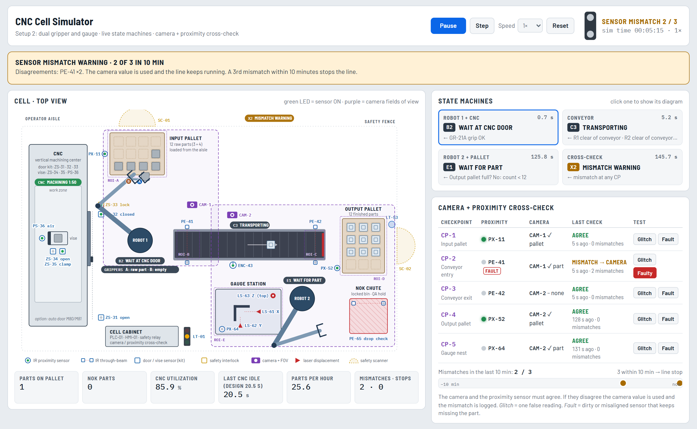

# CNC Cell Simulator

[](https://github.com/juanlopez-gif/CNC-Cell-Simulator/actions/workflows/checks.yml)

Sensors design and live state-machine simulation of a CNC machine-tending cell: a CNC with a
robot-operated door, a UR10e robot with a dual gripper, a conveyor, a second UR10e with a
dimensional gauge, and input and output pallets.

**Live simulator:** https://juanlopez-gif.github.io/CNC-Cell-Simulator/ (runs in the browser, nothing to install)



The project started as the solution to the Week 2 Sensors Design Task (Setup 1 and Setup 2). Since
2026-10-23 it continues with **Setup 2 only**: Robot 1 exchanges the parts at the CNC with a dual
gripper, and Robot 2 measures every part and sorts undersized ones into a NOK chute. The version with
both setups is kept in the branch `legacy-setup1-setup2`; the original submission is in
`submission/`.

## The state machines are one model

The four state machines are data in one file, `source/src/cell-model.js`: states, steps (robot
jobs, camera + proximity checks, waits), transitions with their guards, timers, HMI messages and the
properties the design must keep. The other parts are generated from it or run it:

| Part | What it takes from the model |
|---|---|
| State diagrams (`src/cell-diagrams.js`) | Every box and arrow; the arrow labels are generated from the guards. The generator stops if a transition cannot be drawn |
| Timing chart and CNC idle KPI | The step times of the states in the CNC idle band (20.5 s is computed, not typed) |
| Browser simulation (`sim-src/app.js`) | Nothing about states is written there: an interpreter runs the machines; the file only holds the plant (robot motions, CNC, belt, sensors, operator) and the drawing |
| Python engine (`engine/`) | The same interpreter and plant without graphics, for long runs and analysis; it reads the model exported to JSON and gives the same state changes at the same instants as the browser |
| Verification (`src/cell-verify.js`, `verify.js`) | An abstract model of the same machines, explored state by state, exported to NuSMV (`verification/*.smv`) and checked again with NuSMV |

## What has been checked, and what has not

- `M.lint()`: every name used exists, every sensor named in a diagram text is used, every state is
  reachable.
- `node test_sim.js conform`: 20 h of simulated operation with random faults; every state change is
  a transition of the model, every job takes its model time, no property is violated, and without
  faults the CNC idle time equals the KPI.
- `node verify.js`: every reachable state of the abstract model, nominal and with sensor or process
  faults (up to 14.7 million states). All 13 properties hold and there is no deadlock. NuSMV 2.7.1,
  an independent symbolic model checker, agrees with the search on every property and on the number
  of reachable states. Both read the same generated model, so this is additional evidence that the
  search and the export are consistent, not a check of the abstraction.
- Every push runs these checks on GitHub (badge above), plus a regression check against a recorded
  reference of Setup 2 (`regression/`).

Limits: the abstract model assumes the camera is never wrong and uses a 2-slot output pallet; sensor
and process faults are not combined; the times are planning estimates. The design has not been
validated on a real cell. `PROJECT_STATUS.md` (§1.1 and §13) lists what each check does and does not
show.

These checks found five problems of the first version, all fixed in the model:

- Two latent problems of the original design, hidden by the timing of the simulation (found by the
  verifier): the cycle-start handshake waited for the short "CNC in cycle" signal, and Robot 2 did
  not consume the "pick allowed" signal, so it could try a second pick at an empty exit.
- One rule the original design left open: "wait until CP-2 shows the entry clear". The old
  simulation waited on the true part position, which a PLC cannot read. Robot 1 now waits until the
  conveyor has taken over the previous part (found by the random simulation run).
- Two errors of the first version of the model, caught before release: a too general hold rule, and
  one machine reading a check result written by another one.

## Roadmap

1. **Solid, demonstrable base**: continuous integration and one build command (done); closing the
   design gaps (camera errors in the cross-check rule, the gauge's measurement definition, sources
   and tolerances of the times, KPI definitions, combined faults); a PLC program in IEC 61131-3
   Structured Text generated from the model and run in OpenPLC (a software PLC) against the Python
   engine as the plant; timed verification with UPPAAL; studies with the Python engine; a more
   realistic plant.
2. **Generalization**: the cell becomes a template that can be instantiated several times, with
   the configuration and the part types as data.
3. **Factory**: more CNCs, processes before and after, several part types and parallel lines.

Details and progress in `PROJECT_STATUS.md`, section 15.

## Contents

| Path | What it is |
|---|---|
| `PROJECT_STATUS.md` | Detailed technical reference: state of every part, how it works, checks, limitations, plan and decision log |
| `simulation/index.html` | Interactive simulation of all state machines. Double-click to open it in a browser |
| `simulation/*.png` | Screenshots of the simulation |
| `diagrams/` | Every figure as PNG and SVG (editable), generated from the model |
| `verification/` | NuSMV models of the cell, the NuSMV outputs and the results of the exhaustive verification |
| `engine/` | The simulation engine in Python, without graphics (see `engine/README.md`) |
| `regression/` | Recorded fingerprints of Setup 2 used to show that a change of the code did not change the behaviour |
| `source/` | The model and the scripts that generate the diagrams, the simulation and the verification |
| `submission/` | The original course submission (answer, report, video), historical and not regenerated |

## Figures

| File | What it shows |
|---|---|
| `fig02_control_architecture` | The four state machines and their handshakes |
| `fig03_crosscheck_flow` | Camera + proximity decision logic |
| `fig04_supervisor_states` | Cross-check supervisor state diagram |
| `fig07_states_conveyor` | Conveyor state diagram |
| `fig09_layout_setup2` | Cell layout and sensor placement |
| `fig10_timing_setup1_vs_setup2` | Timing of one CNC cycle against the Setup 1 baseline |
| `fig11_flow_setup2` | Work flow of one part |
| `fig12_states_robot1_setup2` | Robot 1 + CNC state diagram (dual gripper) |
| `fig13_states_robot2_setup2` | Robot 2 + gauge + sorting state diagram |
| `fig14_dual_gripper_exchange` | How Robot 1 swaps the parts with the dual gripper |

The numbers follow the original report; the figures that showed only Setup 1 (1, 5, 6, 8) were removed.

## The cross-check rule in one paragraph

At five checkpoints (CP-1 input pallet, CP-2 conveyor entry, CP-3 conveyor exit, CP-4 output
pallet, CP-5 gauge nest) an IR proximity sensor and a camera confirm the same fact. They must
agree. If they disagree, the sequence uses the camera value and logs a mismatch. Three mismatches
within a 10-minute sliding window stop the line in a controlled way (the CNC finishes its part, the
robots park, the belt starts no new transport) until a technician verifies the sensors and resets.
Safety signals (door interlock, E-stops, scanners) are hardwired and never overridden by the camera.
This rule has not yet been tested against camera errors; that is the next step of the plan.

## Key numbers (nominal)

| | Setup 1 baseline | Setup 2 |
|---|---|---|
| CNC idle per part | 36.5 s | 20.5 s |
| Share of the cycle spent machining | 76.7 % | 85.4 % |
| Output | 23.0 parts/h | 25.6 parts/h |

Nominal values from planning times, without material shortages, pallet changes, holds or repairs.
Every part with a length, width or height below 48.00 mm goes to a locked NOK chute.

## Using the simulation

Open the live link above, or open `simulation/index.html` from a local copy. Set the speed and watch
the active state move on the diagrams. Try **Fault** on CP-2: every part placed on the belt gives a
mismatch, the camera keeps the line running, and the third mismatch within 10 minutes stops the line.
Then start the sensor verification and reset. Press **Next part undersized** twice to see the NOK
chute and the quality hold. The page needs an internet connection only for its fonts.

## Rebuilding

Requires Node.js, Python 3.9+ and Google Chrome (set `CHROME=<path>` if it is not in the usual
place). From `source/`:

```
npm install
npm run build      # diagrams/, simulation/index.html and the model JSON of the Python engine
npm run check      # lint + every generated file is what the sources give
npm test           # headless browser tests, conformance runs, browser-vs-Python comparison
npm run regress    # Setup 2 identical to the recorded reference
npm run verify     # exhaustive verification -> out/verification/ (copy to ../verification/)
cd ../engine && python -m unittest -v test_engine
```

With `NUSMV=<path to NuSMV>` (or NuSMV on the PATH), `verify.js` also checks the three `.smv` files
with NuSMV and compares the verdicts; `NUSMV_ONLY=1` runs only that part again. NuSMV 2.7.1 is free
(LGPL) from https://nusmv.fbk.eu. The NuSMV checks take about an hour on a laptop with
`NUSMV_JOBS=8`, most of it for the run with sensor faults, which also needs about 2 GB of memory.
The same full verification runs on GitHub without a local computer: Actions tab → **full
verification** → Run workflow (or `gh workflow run full-verification.yml`).
