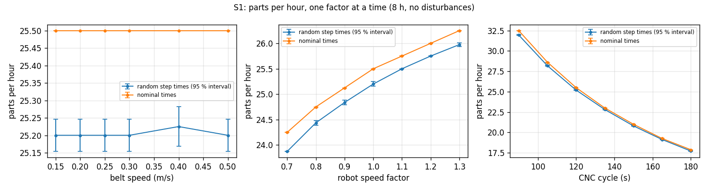
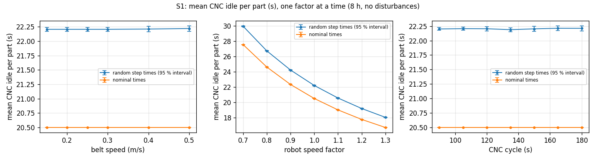
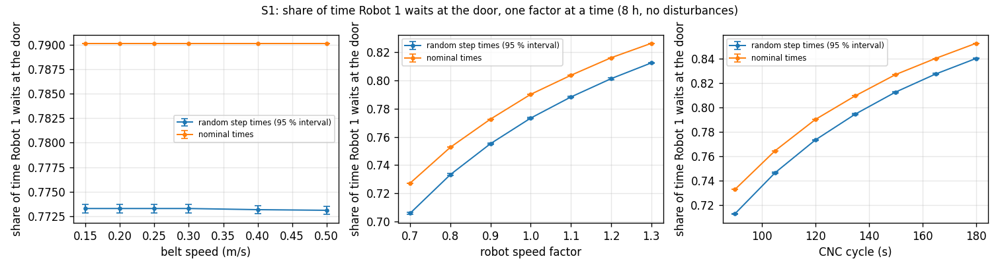
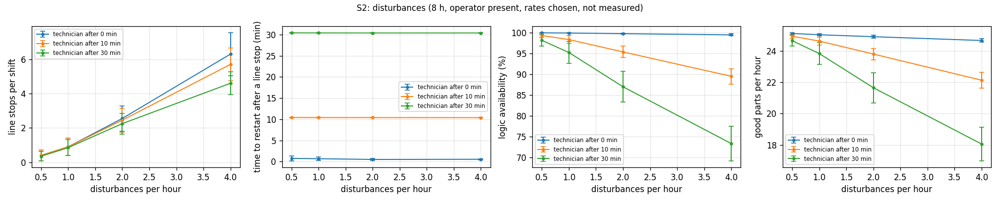
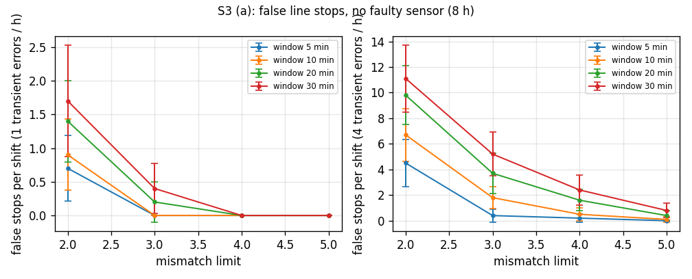
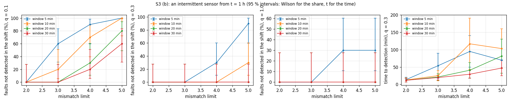
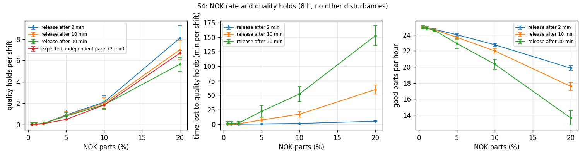

# Studies with the Python engine (step A5)

Four studies of the Setup 2 cell, designed in `PROJECT_STATUS.md` §5.18 and run on the Python
engine (`engine/cellsim`). Every run is one shift of 8 h of simulated time with random step times
(each time drawn in its interval, A4.4); every point has n independent seeds, the same seeds at every
point (common random numbers). Values are means with their **95 % interval** (Student t over the
seeds; for a share, Wilson). The model is never changed: a study changes a value in a copy of the
model data in memory.

Run on 2026-11-01 by the workflow `studies` (GitHub Actions, run 41333134738): **1 620 runs, no
model error, no property violation** (every state change a model transition, every property of
§5.11 held). The outputs are in `out/`: one CSV per study with one row per run (`s*_runs.csv`), the
summaries (`s*_summary.csv`) and the plots.

```
cd engine
python -m studies.s1_sweeps            # also s2_disturbances, s3_crosscheck, s4_nok; --quick for a short check
gh workflow run studies.yml            # all four in GitHub Actions (about 1.5 h, S3 the longest)
```

**What these numbers are.** The disturbance rates, the response times of the operator and the
technician, the NOK rates and the faulty sensors are **chosen, not measured**. The studies show how
the designed cell reacts and where its thresholds lie, not the availability of a real cell. Rule
values other than 3 mismatches in 10 minutes are simulated only; the formal verification (§9) and
the PLC (§5.16) cover the model values.

## S1 Parameter sweeps (no disturbances)

One factor at a time around the nominal cell; n = 10 seeds with random times and one run with
nominal times per point (`s1_summary.csv`). Nominal cell: 25.5 parts per hour with nominal times
(25.2 ± 0.05 with random times), CNC idle 20.5 s per part (22.2 ± 0.04 s).

| Factor | Range | Parts per hour (random times) | Mean CNC idle per part | Robot 1 waiting at the CNC door |
|---|---|---|---|---|
| Belt speed | 0.15–0.50 m/s | 25.2 at every speed | 22.2 s at every speed | 77 % |
| Robot speed factor | 0.7 → 1.3 | 23.9 → 26.0 | 30.0 → 18.0 s | 71 → 81 % |
| CNC cycle | 90 → 180 s | 32.0 → 17.7 | 22.2 s at every cycle | 71 → 84 % |





Reading:

- **The CNC is the bottleneck over every range studied.** Robot 1 waits at the closed CNC door
  71–85 % of the shift and Robot 2 waits for a part 85–92 %. Even a 90-s cycle leaves Robot 1 waiting
  71 % of the time, so the robots could serve a much faster machine; the crossover lies below 90 s,
  outside the approved range.
- **The belt speed has no effect at all** (the same parts and idle to every digit with nominal times):
  the belt carries the next raw part while the CNC machines, off the critical path of the exchange.
  A slower, cheaper belt down to 0.15 m/s costs nothing.
- **The CNC idle per part is the exchange time** and depends only on the robots: 20.5 s nominal, from
  27.6 s (robots at 70 %) to 16.7 s (130 %) with nominal times. It does not depend on the CNC cycle.
  Parts per hour follow 3600 / (cycle + idle).
- Random times cost about 0.3 parts per hour against nominal times (the intervals of robot moves are
  skewed towards slower, −10 / +30 %, §5.1.1).
- Some intervals are 0: every seed made the same whole number of parts in the shift.

## S2 Disturbances (Monte Carlo)

Disturbances at 0.5, 1, 2 and 4 per hour with the mix of `run_random` (glitch 30 %, sensor fault
15 %, bad frame 15 %, camera failure 10 %, grip miss 15 %, undersized part 10 %, master check out of
tolerance 5 %; a sensor fault stays until the technician repairs it). The operator is present all the
time: clears a FAULT after 60 s and releases a quality hold after 120 s. The technician starts the
sensor verification 0, 10 or 30 min after a line stop. n = 20 per point (`s2_summary.csv`).

| Disturbances per hour | Technician after | Line stops per shift | FAULTs per shift | Restart after a line stop, mean / 95th pct. (min) | Logic availability | Good parts per hour |
|---|---|---|---|---|---|---|
| 0.5 | 0 min | 0.40 ± 0.32 | 1.9 | 0.8 / 1.5 | 99.9 % | 25.1 |
| 0.5 | 30 min | 0.35 ± 0.28 | 2.0 | 30.4 / 30.5 | 98.1 ± 1.4 % | 24.7 |
| 1 | 0 min | 0.90 ± 0.50 | 3.8 | 0.7 / 1.5 | 99.9 % | 25.1 |
| 1 | 10 min | 0.90 ± 0.50 | 3.8 | 10.4 / 10.5 | 98.3 ± 0.9 % | 24.6 |
| 1 | 30 min | 0.85 ± 0.46 | 3.8 | 30.4 / 30.5 | 95.2 ± 2.7 % | 23.8 ± 0.7 |
| 2 | 10 min | 2.45 ± 0.69 | 6.6 | 10.4 / 10.5 | 95.3 ± 1.4 % | 23.8 ± 0.4 |
| 2 | 30 min | 2.25 ± 0.61 | 6.3 | 30.4 / 30.5 | 87.0 ± 3.7 % | 21.7 ± 1.0 |
| 4 | 0 min | 6.30 ± 1.25 | 14.2 | 0.6 / 1.5 | 99.5 ± 0.2 % | 24.7 |
| 4 | 10 min | 5.70 ± 0.95 | 13.2 | 10.4 / 10.5 | 89.5 ± 1.9 % | 22.1 ± 0.5 |
| 4 | 30 min | 4.60 ± 0.67 | 11.7 | 30.4 / 30.5 | 73.3 ± 4.2 % | 18.1 ± 1.1 |

All 12 points are in `s2_summary.csv`. Restart after a FAULT: 1.24 min on average, 95th percentile
1.33 min, at every point (the operator's 60 s and the robot's recovery).



Reading:

- **The technician's response time decides the availability; the FAULTs do not.** With the operator
  present a FAULT costs about 1.2 min, and the cell's own recovery after a line stop (verification and
  reset) takes under 1.5 min. A line stop costs the technician's delay plus that.
- With a technician at once the logic availability stays above 99.5 % even at 4 disturbances per hour.
  With 30 min it falls to 87 % at 2 per hour and 73 % at 4 per hour (−28 % good parts).
- Line stops grow faster than the rate (0.4 → 6.3 per shift for ×8 disturbances): at higher rates more
  transient errors fall inside one mismatch window. At 4 per hour a slow technician sees fewer stops
  (4.6 against 6.3), most likely because a stopped line makes no checks, so errors injected during a
  stop cause no mismatch.
- Line stops below one per shift (rate ≤ 1 per hour) have wide intervals with n = 20.

## S3 The cross-check rule

The rule stops the line at the N-th mismatch between the proximity sensor and the camera within a
window. The model has 3 mismatches in 10 minutes. N = 2, 3, 4, 5 × window 5, 10, 20, 30 min. The
operator clears a FAULT after 60 s, the technician starts the verification at once after a line stop.
n = 10 per point.

**(a) False stops.** No faulty sensor; transient errors only (a single proximity glitch, a wrong
camera answer with a valid image, a stale image) at a random checkpoint, 1 or 4 per hour. Every line
stop is a false stop (`s3a_summary.csv`).

| Limit | Window 5 min | 10 min | 20 min | 30 min |
|---|---|---|---|---|
| 2, at 1 / 4 per hour | 0.7 / 4.5 | 0.9 / 6.7 | 1.4 / 9.8 | 1.7 / 11.1 |
| **3**, at 1 / 4 per hour | 0 / 0.4 | **0 / 1.8 ± 0.9** | 0.2 / 3.7 | 0.4 / 5.2 |
| 4, at 1 / 4 per hour | 0 / 0.2 | 0 / 0.5 | 0 / 1.6 | 0 / 2.4 |
| 5, at 1 / 4 per hour | 0 / 0 | 0 / 0.1 | 0 / 0.4 | 0 / 0.8 |



**(b) An intermittent sensor.** From t = 1 h the proximity sensor of one checkpoint (drawn per run)
misses the object at each check with probability q = 0.1, 0.3 or 1 (q = 1 is a dead sensor). The run
ends at the first line stop after that (the technician finds the sensor) or at the end of the shift
(not detected). Each miss is a mismatch, and where the PLC waits for that sensor's confirmation it is
also a FAULT, cleared by the operator after 60 s (§5.3) (`s3b_summary.csv`).

| Limit / window | q = 0.1: not detected in the shift | q = 0.1: time to detection | q = 0.3: not detected | q = 0.3: time to detection | q = 1: time to detection | FAULTs before detection, q = 0.1 / 0.3 / 1 |
|---|---|---|---|---|---|---|
| 2 / 10 min | 0 % (0–28 %) | 128 ± 59 min | 0 % | 12.8 ± 6.3 min | 3.0 min | 2.1 / 1.2 / 1.2 |
| **3 / 10 min** | **20 % (6–51 %)** | 196 ± 88 min | 0 % | 25 ± 15 min | 4.6 min | 5.2 / 3.0 / 1.9 |
| 3 / 20 min | 0 % (0–28 %) | 189 ± 75 min | 0 % | 21 ± 9 min | 4.6 min | 4.1 / 2.1 / 1.9 |
| 3 / 30 min | 0 % (0–28 %) | 164 ± 65 min | 0 % | 20 ± 7 min | 4.6 min | 3.4 / 1.8 / 1.9 |
| 4 / 10 min | 70 % (40–89 %) | — | 0 % | 117 ± 74 min | 6.1 min | 10.2 / 6.6 / 2.6 |
| 4 / 30 min | 20 % (6–51 %) | 207 ± 120 min | 0 % | 29 ± 11 min | 6.1 min | 6.0 / 2.6 / 2.6 |
| 5 / 5 min | 100 % (72–100 %) | — | 90 % | — | 5.9 min (30 % not detected) | 12.9 / 41.5 / 3.3 |
| 5 / 30 min | 60 % (31–83 %) | — | 0 % | 47 ± 22 min | 7.6 min | 10.2 / 3.5 / 3.3 |

Shares not detected are given with their Wilson interval; times only over the detected runs. All 48
points are in `s3b_summary.csv`.



Reading:

- **The model's rule (3 in 10 min) gives no false stop at 1 transient error per hour and 1.8 per shift
  at 4 per hour.** It finds a dead sensor in under 5 min and a sensor that misses 30 % of the checks
  in about 25 min, but **misses a sensor that fails 10 % of the checks in about 1 run in 5** within the
  shift, while it causes about 5 FAULTs.
- **The window matters more than expected for the intermittent sensor, and in the other direction
  from the false stops.** The FAULTs the faulty sensor causes slow the cell down, so its mismatches
  come more slowly than its misses: with a short window they rarely add up. At limit 4–5 and a 5-min
  window even a dead sensor is not found in 30 % of the shifts, and at 5 / 5 min a sensor with
  q = 0.3 causes about 40 FAULTs in the shift without stopping the line.
- **A wider window trades false stops for detection.** 3 in 20 min detected every intermittent sensor
  of the study (q = 0.1 in 189 ± 75 min) at the cost of 3.7 instead of 1.8 false stops per shift at
  4 transient errors per hour; 4 in 30 min has fewer false stops (2.4) and misses 20 %. Limit 2 detects
  everything quickly but stops 7–11 times per shift at 4 errors per hour.
- No point is better in every measure. Changing the rule is the author's decision (§15 rule); the
  verification and the PLC are done for 3 in 10 min.
- n = 10 leaves wide intervals on the shares (a share of 0 out of 10 is 0–28 %).

## S4 NOK rate and quality holds

Every raw part comes out of the CNC undersized with probability p, independently (`CellSim(nok_rate=p)`).
The rule of the model puts the cell in quality hold after 2 NOK parts in a row; the operator
releases it after 2, 10 or 30 min. No other disturbance. n = 20 per point (`s4_summary.csv`).
"Expected" is the number of holds of the rule for independent parts: one per completed pair of NOK
in a row, p² / (1 + p) per part measured outside a hold.

| NOK parts | Holds per shift (release after 2 min) | Expected | Time lost to holds per shift: 2 / 10 / 30 min | Good parts per hour: 2 / 10 / 30 min |
|---|---|---|---|---|
| 0.5 % | 0.05 ± 0.11 | 0.005 | 0 / 0.4 / 1.4 min | 25.0 / 25.0 / 24.9 |
| 1 % | 0.05 ± 0.11 | 0.02 | 0 / 0.4 / 1.4 min | 24.9 / 24.9 / 24.8 |
| 2 % | 0.10 ± 0.14 | 0.08 | 0.1 / 0.9 / 2.2 min | 24.7 / 24.7 / 24.6 |
| 5 % | 0.90 ± 0.45 | 0.48 | 0.6 / 7.4 / 22 min | 24.0 / 23.7 / 22.9 ± 0.6 |
| 10 % | 2.10 ± 0.59 | 1.83 | 1.4 / 17 / 52 min | 22.8 / 22.0 / 20.3 ± 0.6 |
| 20 % | 8.10 ± 1.16 | 6.69 | 5.2 / 60 / 152 min | 19.9 / 17.6 / 13.7 ± 0.9 |



Reading:

- **The hold rule behaves exactly as designed.** In every run checked the holds equal the count of
  "2 NOK in a row" in that run's own sequence of verdicts, and the verdicts are independent
  (P(NOK) = 0.198, P(NOK after a NOK) = 0.199 over 3 000 parts at p = 20 %). The holds lie a little
  above the expected value (8.1 against 6.7 at 20 %) because these 20 seeds drew more NOK parts than p
  (20.9 % at p = 20 %); with common random numbers the three release times share that draw.
- **Below 2 % NOK the hold practically never fires** (at most one shift in ten): the rule does not stop
  the cell for scattered bad parts. At 5 % it fires about once a shift, at 20 % eight times.
- **With an operator who releases at once, a hold costs almost nothing beyond the scrap**: good parts
  per hour follow 25.2 × (1 − p) within 0.3. With a 30-min release the holds cost as much as the scrap
  itself at 10 % NOK (20.3 instead of 22.8) and at 20 % the cell makes 13.7 good parts per hour instead
  of 19.9.
- The rule detects a process that has gone wrong (many NOK), not a single bad part; how quickly it
  reacts to a sudden tool failure is not part of this study.

## What the studies change in the plan

Nothing is changed by the studies themselves. Open points for the author:

- **The cross-check rule**: 3 in 10 min misses about 1 in 5 sensors that fail 10 % of the checks within
  a shift (S3 b); 3 in 20 min detected all of them, with about 2 more false stops per shift at 4
  transient errors per hour. Any change needs the verification and the PLC run again.
- **The CNC is always the bottleneck** in the approved ranges (S1). Cycles below 90 s would show where
  the robots take over; that is outside the approved design of A5.
- **The technician's response time** is the main lever on availability (S2); it belongs to the
  factory model (phase C), not to the cell.
